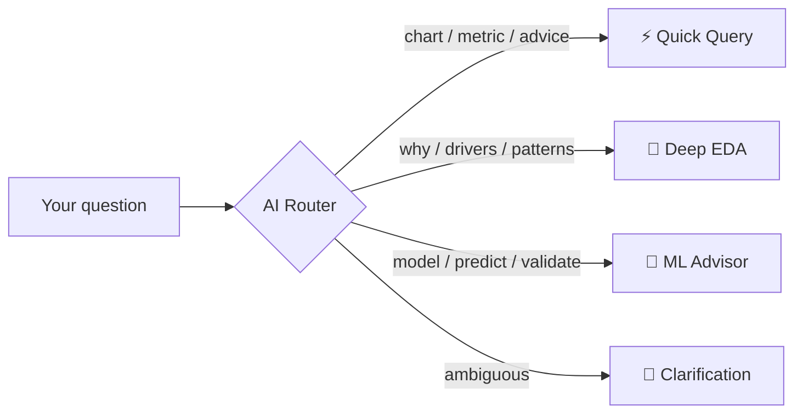
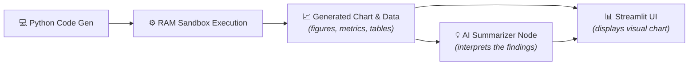
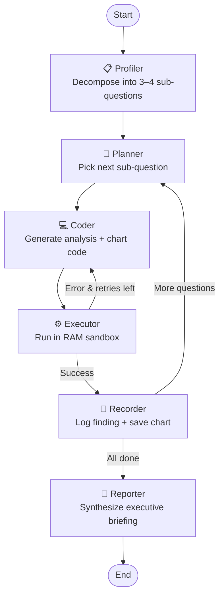
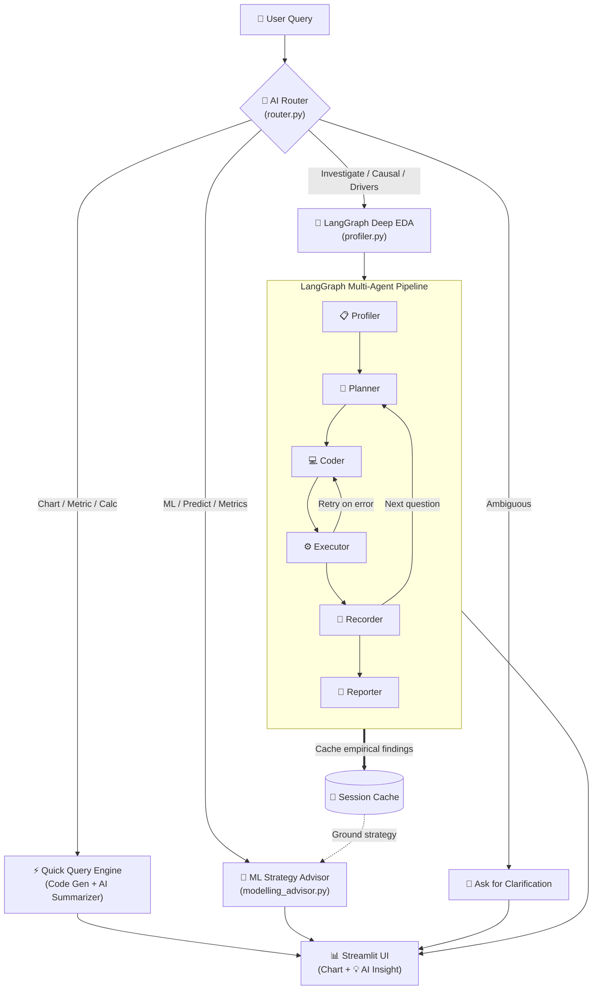
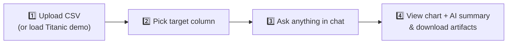
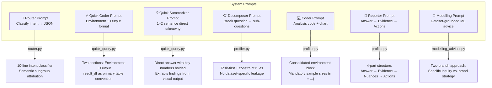

<div align="center">

# 📊 AI Data Analyst & Autonomous EDA Agent

### Conversational Data Analysis with AI Routing & LangGraph

[](https://www.python.org/)
[](https://streamlit.io/)
[](https://langchain-ai.github.io/langgraph/)
[](https://python.langchain.com/)
[](https://openrouter.ai/)
[](LICENSE)

**Upload any CSV → Ask questions in plain English → Get instant charts with AI summaries, deep investigations, or ML strategy advice — automatically.**

[Features](#features) · [Architecture](#architecture) · [Quick Start](#quick-start) · [How to Use](#how-to-use) · [How It Works](#how-it-works) · [Tech Stack](#model-allocation) · [License](#license)

</div>

---

## 🧩 What Is This?

A **conversational AI data analyst** that understands what you're asking and picks the right tool for the job — instantly. Upload a dataset, type a question, and it figures out whether you need a quick chart with an insight summary, a multi-step investigation, or ML modeling advice.

| Path | What It Does | Speed |
|:-----|:-------------|:------|
| ⚡ **Quick Query** | Sandboxed charts and tables paired with a 1–2 sentence AI insight summary | ~1–2s |
| 🧠 **Deep EDA** | Multi-step hypothesis investigation with live code, charts, and an executive briefing | ~15–25s |
| 🤖 **ML Advisor** | Tailored modeling strategy: algorithms, validation, feature engineering, metrics | ~10–15s |

---

## 🚀 Features

### 🧭 Smart Query Router



- Analyzes your input against the dataset schema and conversation history.
- **AI-first routing:** LLM intent classification runs first; keyword heuristics serve as a fallback if the API times out.
- Causal inquiries, mechanism tests, and subgroup attribution (*"was X driven by Y?"*) are automatically directed to Deep EDA.
- Falls back to a friendly clarification prompt when your intent is unclear.

### ⚡ Quick Query Engine with AI Insight Summarizer



- **Dual-Pane View:** Generates and runs sandboxed Python code in RAM — the chart or table renders immediately, followed by a streamed **💡 AI Insight** that directly answers the question with key numbers bolded.
- **Concise & Direct:** The summarizer skips code explanations and focuses strictly on what the visual data shows in 1–2 sentences.
- **Clean Interface:** Raw printed calculations and console logs are tucked into a collapsed expander for deep verification.
- **Silent & Clean:** Automatically suppresses deprecation warnings (e.g. pandas `observed=False` future defaults).
- **Security:** Sandboxed execution with restricted builtins, a 15-second timeout, AST-level validation, and auto-repair on syntax errors.

### 🧠 Deep Autonomous EDA (LangGraph)

A stateful multi-agent pipeline that breaks your question into sub-hypotheses, investigates each one, and synthesizes an executive briefing.



- **Resilient Multi-Agent Execution:** Retries code once on syntax or runtime error, with domain-aware column matching (`_find_best_column`) to prevent missing column failures.
- **Transparent Status:** If an external API rate limit occurs, the report surfaces the exact cause rather than generating generic filler.
- Step charts are displayed in an interactive gallery and downloadable as a `.zip` archive.
- Verified empirical findings are **cached in session memory** and passed to the ML Advisor.

### 🤖 ML Strategy Advisor

- **Specific question?** (e.g., *"Which imputation method for Cabin?"* or *"LightGBM vs CatBoost"*) → direct, dataset-grounded answer.
- **Broad request?** → bespoke strategy organized around your dataset's real bottlenecks (sample size, class imbalance, cardinality).
- Incorporates prior EDA findings automatically — zero redundant compute.

---

## 🏗️ Architecture



---

## 🤖 Model Allocation

| Component | Module | Model | Purpose | Latency |
|:----------|:-------|:------|:--------|:--------|
| AI Router | `router.py` | `nemotron-3.5-lightning` | AI intent classification with heuristic fallback | < 500ms |
| Quick Coder | `quick_query.py` | `nemotron-3.5-lightning` | Single-shot Python code generation | ~1s |
| AI Summarizer | `quick_query.py` | `nemotron-3.5-lightning` | 1–2 sentence chart & output takeaway | ~500ms |
| Deep EDA | `profiler.py` | `nemotron-3.5-lightning` / `ultra-550b` | Multi-agent hypothesis decomposition & reporting | ~15–25s |
| ML Advisor | `modelling_advisor.py` | `nemotron-3.5-lightning` | Prescriptive ML strategy & validation schemes | ~10–15s |

> **Note:** All models accessed via [OpenRouter](https://openrouter.ai/) free-tier endpoints. Swap any model by editing `.env`.

---

## 📂 Project Structure

```
📦 EDA-Agent/
├── app.py                  # Streamlit UI — unified conversational interface with AI Insight stream
├── router.py               # AI Intent Router — 4-way query classification with semantic mapping
├── quick_query.py          # Fast-path engine — sandboxed execution + AI chart summarizer
├── profiler.py             # LangGraph EDA — multi-agent empirical investigation pipeline
├── modelling_advisor.py    # ML Strategy Advisor — prescriptive modeling recommendations
├── requirements.txt        # Python dependencies
├── .env.example            # Configuration template
├── .gitignore
├── LICENSE                 # MIT
├── Titanic-Dataset.csv     # Built-in demo dataset
└── outputs/                # Generated at runtime
    ├── report.md           #   Latest EDA executive briefing
    └── step_*.png          #   Investigation step charts
```

---

## ⚡ Quick Start

### Prerequisites

- **Python 3.10+** (tested on 3.11, 3.12, 3.13)
- An **[OpenRouter API Key](https://openrouter.ai/keys)** (free tier works)

### 1. Clone & Setup

```bash
git clone https://github.com/Deathslayer007/EDA-Agent.git
cd EDA-Agent
python -m venv venv

# macOS / Linux
source venv/bin/activate

# Windows
venv\Scripts\activate
```

### 2. Install Dependencies

```bash
pip install -r requirements.txt
```

### 3. Configure

Create a `.env` file in the project root:

```env
OPENROUTER_API_KEY=your_key_here

# Optional — defaults shown
FAST_MODEL=nvidia/nemotron-3.5-lightning:free
REASONING_MODEL=nvidia/nemotron-3-ultra-550b-a55b:free
```

### 4. Launch

```bash
streamlit run app.py
```

Opens at `http://localhost:8501`.

---

## 📖 How to Use



**Step 1** — Upload a CSV in the sidebar, or click **🚢 Load Titanic Demo**.

**Step 2** — Select the target/outcome column (auto-detected for common names like `Survived`, `Churn`, `Target`).

**Step 3** — Type any question. The router handles the rest:

| You type | Route | What happens |
|:---------|:------|:-------------|
| *"Plot age distribution by class"* | ⚡ Quick Query | Renders chart/table + streams a **1–2 sentence AI insight** |
| *"Why did third-class passengers die?"* | 🧠 Deep EDA | Runs multi-step investigation, generates briefing & charts |
| *"Best ML model for this dataset?"* | 🤖 ML Advisor | Delivers tailored strategy grounded in your data |
| *"fare"* | 💬 Clarification | Prompts for more detail before proceeding |

**Step 4** — Download the EDA report (`.md`) or step charts (`.zip`) from the sidebar.

---

## 🔧 How It Works

### Prompt Architecture

Each module uses a focused, single-responsibility prompt designed for efficiency and precision:



**Design principles behind the prompts:**

- **Concise & Fast** — prompts specify *what to do* once without repetitive lectures. Shorter prompts yield faster inference and lower token costs.
- **Structured** — labeled sections (ENVIRONMENT, OUTPUT FORMAT, RULES) ensure clean parsing.
- **Direct & User-Focused** — answers lead with the primary finding and key metrics rather than explaining the methodology.
- **Dataset-Agnostic** — no hardcoded domain examples in system prompts, ensuring compatibility with any tabular dataset.

### Module Details

| Module | Prompt | Purpose |
|:-------|:-------|:--------|
| `router.py` | `ROUTER_SYSTEM` | Classifies intent into one of 4 categories. Outputs raw JSON with intent, confidence, and reasoning. |
| `quick_query.py` | `QUICK_CODER_SYSTEM` | Generates sandboxed Python code. Tables → `result_df`; metrics → formatted text; charts → matplotlib. |
| `quick_query.py` | `SUMMARIZER_SYSTEM` | Summarizes visual chart or table findings into a 1–2 sentence direct answer with key numbers bolded. |
| `profiler.py` | `DECOMPOSER_SYSTEM` | Breaks the user's question into 3–4 empirical sub-questions tailored to their inquiry. |
| `profiler.py` | `CODER_SYSTEM` | Writes analysis scripts for each step with mandatory group sample sizes ($n = \dots$). |
| `profiler.py` | `REPORTER_SYSTEM` | Synthesizes findings into an executive briefing: answer first, followed by empirical metrics and actions. |
| `modelling_advisor.py` | `MODELLING_SYSTEM_PROMPT` | Provides prescriptive ML guidance: algorithm candidates, validation schemes, and feature recipes. |

---

## 📄 License

This project is licensed under the **MIT License** — see the [LICENSE](LICENSE) file for details.
